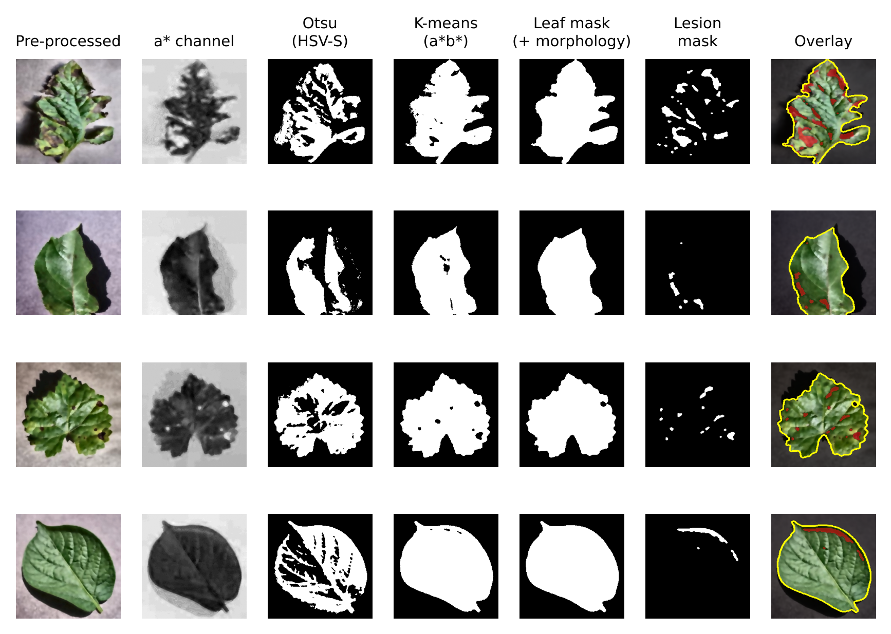
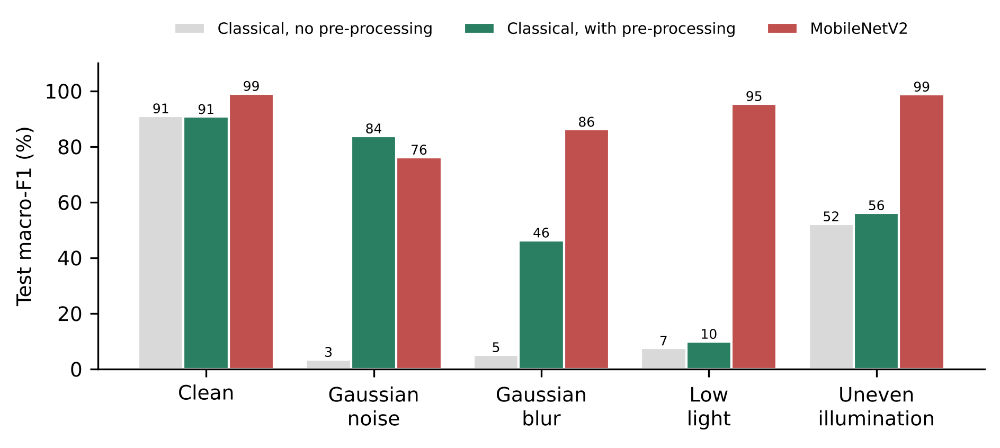

# Safe Gardens

**Automated Detection and Classification of Plant Leaf Diseases Using Color Space Segmentation, Texture Feature Analysis, and Deep Learning**

ARTI 403 – Image Processing · Course Project · **Group 2**
College of Computer Science & IT, Imam Abdulrahman Bin Faisal University

| No. | Team member | Student ID | Role |
|---|---|---|---|
| 1 | Nawaf Rabee Shahbal (**Team Leader**) | 2240009025 | Project lead & pipeline architect |
| 2 | Abbas Abdulaziz Al Thunayan | 2240004112 | DIP pre-processing |
| 3 | Mohammed Nasser Al-Marhoon | 2240005893 | Colour segmentation |
| 4 | Faisal Abdullah Alshehri | 2240001737 | Morphology & feature analysis |
| 5 | Saad Abdulaziz Alshehri | 2240006495 | Machine learning & CNN |
| 6 | Mohammed Sameer Alajlan | 2240002025 | Evaluation & visualisation |

---

## Highlights

| | |
|---|---|
| Classes / crops | **38** classes, 14 crop species (PlantVillage) |
| Images used | **11,227** (train 7,858 · val 1,684 · test 1,685) |
| Leaf segmentation | **IoU 0.920**, Dice 0.949 vs. 555 reference masks |
| Classical DIP pipeline (SVM) | **90.74%** accuracy · macro-F1 90.76% |
| MobileNetV2 (fine-tuned) | **99.05%** accuracy · macro-F1 99.06% |
| Pre-processing under noise | classical macro-F1 3.41% → **83.79%** |



## Pipeline

```
RGB leaf ─► Pre-processing ─► Leaf segmentation ─► Lesion segmentation ─► Features ─► Classifier
            Gaussian 5×5      K-means (k=3) on       K-means in leaf,       colour moments    SVM (RBF)
            Bilateral         Lab a*b* + closing/    Otsu on a*, hue gate,  GLCM + LBP        Random Forest
            CLAHE on L*       opening, largest CC,   dark necrosis,         lesion shape      ── vs ──
                              hole filling           opening/closing        HOG               MobileNetV2
```

## Repository structure

```
Project_Safe_Gardens/
├── notebooks/
│   └── Safe_Gardens_Pipeline.ipynb   ← complete implementation, executed with all outputs:
│                                       setup · dataset download & split · pre-processing ·
│                                       segmentation & morphology · feature extraction ·
│                                       SVM / Random Forest · MobileNetV2 · evaluation & figures
├── models/                           trained SVM and MobileNetV2 weights
├── results/
│   ├── figures/                      all plots (PNG, 300 dpi)
│   └── tables/                       metrics (CSV / JSON), classification reports, data split
├── paper/                            research paper (Word + PDF, IEEE conference format)
├── slides/                           presentation (PowerPoint)
├── proposal/                         project proposal
└── data/                             dataset instructions (images are downloaded, not stored)
```

## Results

### Leaf segmentation (555 reference masks, pre-processed input)

| Method | IoU | Dice | ms / image |
|---|---|---|---|
| Otsu (HSV-S) | 0.690 | 0.792 | 0.1 |
| Otsu + morphology | 0.722 | 0.803 | 1.9 |
| K-means (Lab a*b*) | 0.916 | 0.947 | 9.7 |
| Otsu/K-means fusion + morph. | 0.903 | 0.942 | 11.5 |
| K-means + GrabCut | 0.906 | 0.941 | 63.3 |
| K-means + morphology (proposed) | 0.920 | 0.949 | 11.6 |

### Feature groups (test set, macro-F1 %)

| Features | Dim. | SVM | Random Forest |
|---|---|---|---|
| Colour | 78 | 81.47 | 74.39 |
| Texture (GLCM+LBP) | 64 | 71.54 | 58.67 |
| Shape | 8 | 48.28 | 45.93 |
| HOG | 1764 | 69.77 | 52.93 |
| Colour+Texture | 142 | 88.90 | 84.13 |
| Colour+Texture+Shape | 150 | 90.76 | 86.25 |
| All (C+T+S+HOG) | 1914 | 85.94 | 84.28 |

### Main comparison (test set, %)

| Model | Accuracy | Precision | Recall | Macro-F1 | ROC-AUC |
|---|---|---|---|---|---|
| SVM – Colour+Texture+Shape | 90.74 | 91.04 | 90.69 | 90.76 | 0.995 |
| Random Forest – Colour+Texture+Shape | 86.47 | 86.58 | 86.36 | 86.25 | 0.995 |
| SVM – HOG only | 69.85 | 70.34 | 69.87 | 69.77 | 0.968 |
| MobileNetV2 (fine-tuned) | 99.05 | 99.10 | 99.06 | 99.06 | 1.000 |

### Ablation (SVM, Colour+Texture+Shape)

| Setting | Accuracy % | Macro-F1 % |
|---|---|---|
| Full pipeline (pre-processing + leaf mask) | 90.74 | 90.76 |
| Without pre-processing | 90.92 | 91.00 |
| Without leaf segmentation mask | 94.66 | 94.71 |

> Removing the leaf mask *increases* accuracy because PlantVillage backgrounds are correlated with the class (capture bias, see Noyan 2022). The masked pipeline uses leaf evidence only.

### Robustness (macro-F1 % on degraded test images)

| Condition | Classical, no pre-processing | Classical + pre-processing | MobileNetV2 |
|---|---|---|---|
| Clean | 91.00 | 90.76 | 99.06 |
| Gaussian noise (σ=20) | 3.41 | 83.79 | 76.16 |
| Gaussian blur (7×7) | 5.12 | 46.33 | 86.19 |
| Low light (γ=2.2) | 7.49 | 9.89 | 95.44 |
| Uneven illumination | 52.17 | 56.16 | 98.83 |



## How to run

```bash
pip install -r requirements.txt
jupyter notebook notebooks/Safe_Gardens_Pipeline.ipynb
```

Run all cells. The first run needs the data: set `DOWNLOAD_DATA = True` in the setup cell (≈1 min) and place the MobileNetV2 ImageNet weights in `data/weights/` (see `data/README.md`). Cached features, models and results are reused; set `RECOMPUTE_FEATURES`, `RECOMPUTE_SEG_EVAL`, `RETRAIN_CLASSICAL` and `RETRAIN_CNN` to `True` to recompute everything (≈ 2 h on a 2-core CPU).

## Dataset

PlantVillage – D. P. Hughes and M. Salathé, *An open access repository of images on plant health to enable the development of mobile disease diagnostics*, arXiv:1511.08060, 2015.
Mirror used: https://github.com/spMohanty/PlantVillage-Dataset · also https://data.mendeley.com/datasets/tywbtsjrjv/1 and https://www.kaggle.com/datasets/emmarex/plantdisease · accessed 17 Oct 2026.

## Acknowledgements

MobileNetV2 ImageNet weights from https://github.com/d-li14/mobilenetv2.pytorch (Apache-2.0).
